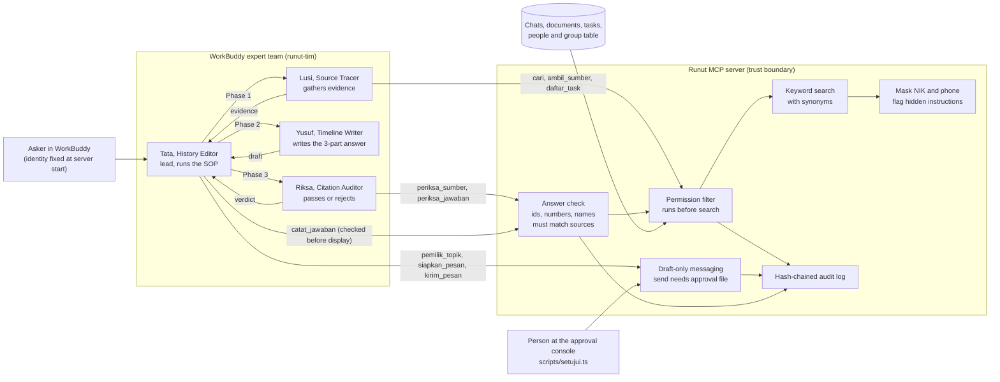

# Runut architecture

The trust boundary sits in the Runut MCP server, not in any prompt. Everything the model sees has already passed the permission filter.

## Components

| Component | Role | Why it is built this way |
| --- | --- | --- |
| WorkBuddy expert team | Four agents with separate jobs. The lead never writes a member's output and relays every message. | A single prompt that searches, writes and checks itself tends to approve its own mistakes. A separate auditor with its own instructions catches unsupported sentences and wording that hints at hidden data. |
| Runut MCP server | The only door to company data. Bundled inside the WorkBuddy plugin so every team member gets the same tools. | WorkBuddy only shares plugin MCP servers with expert team agents. Keeping the rules in code means a prompt injection or a model slip cannot widen access. |
| Permission filter | Keeps only items whose group list overlaps the asker's groups, then searches. | Filtering after search would let restricted text reach the model. Data is re-read on every call, so access changes apply at once. |
| Uniform empty answer | Restricted and non-existent items both return "Tidak ada data yang cocok." | The handbook test for "Proyek Kenari" requires that nothing confirms it exists. |
| Masking and instruction flags | NIK and phone numbers are masked unless an HR user asks. Text that addresses the AI is marked as data. | Personal data protection and prompt injection are handled before the model sees the text. |
| Answer check (`periksa_jawaban`) | Every line of an answer must cite ids that exist and are visible to the asker, and its numbers and proper names must appear in the cited sources. `catat_jawaban` runs it and returns `lolos: false` for an answer that may not be shown. | Added after a test run in which the writer invented a story and attached one real source. Prompts asked it not to. Code now refuses it. |
| Draft-only messaging | `siapkan_pesan` writes a draft. `kirim_pesan` refuses until a person writes an approval through the console. | The model has no tool that approves, so asking first is enforced, not requested. |
| Audit log | Every call is appended with the hash of the previous line. | Anyone can check later what was asked, what was retrieved and what was answered, and tampering shows. |

## Trade-offs

| Choice | What we gave up | Why |
| --- | --- | --- |
| Keyword search instead of embeddings | Some recall for loosely worded questions | Deterministic, explainable, no extra service, and a miss produces "not found" instead of a wrong answer |
| Identity from server config | No single sign-on in the prototype | Keeps identity out of the model's reach. Production would bind it to the signed-in employee. |
| Three-phase team for every factual answer | More credits and about one to three minutes per answer | Separate writer and auditor roles. Empty-evidence questions skip phases 2 and 3 and return in about 30 seconds. |
| Local approval console | Same machine as WorkBuddy | Enough to prove the gate. Production would move approval to a separate channel. |
