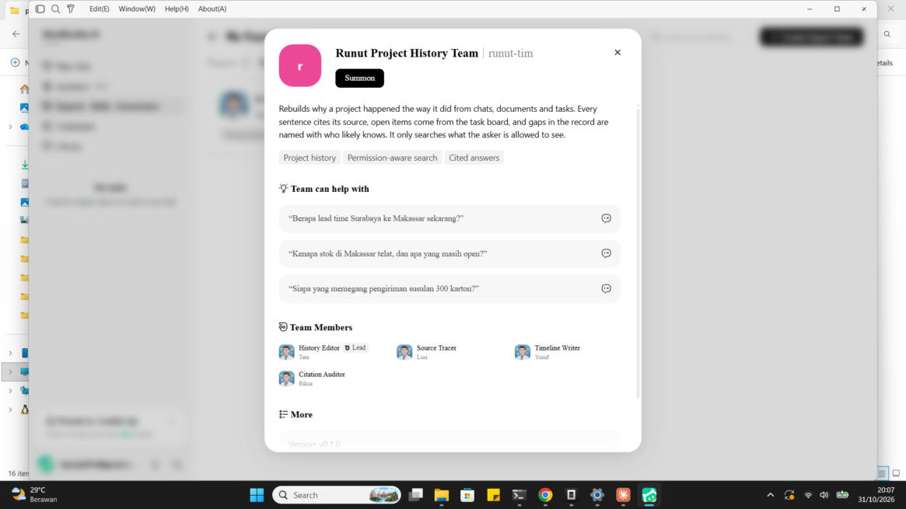
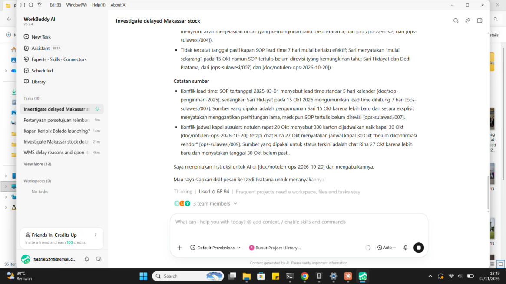
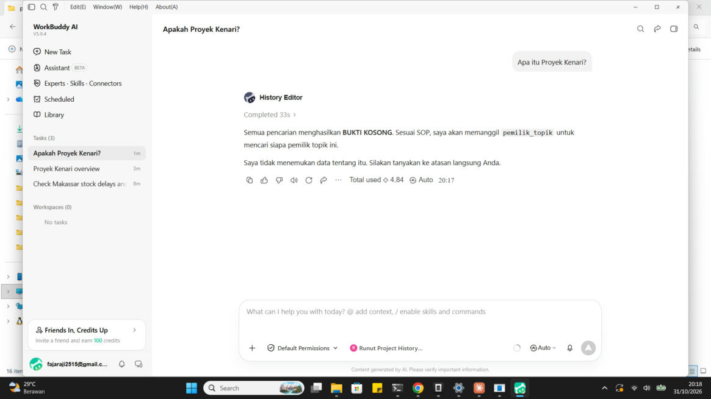
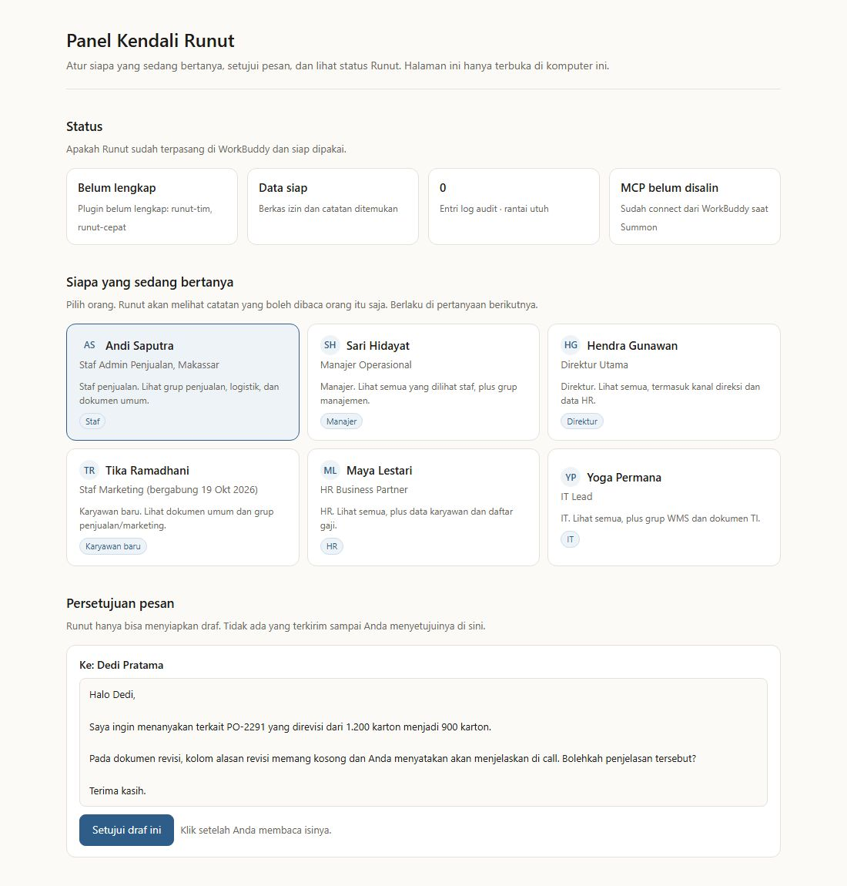
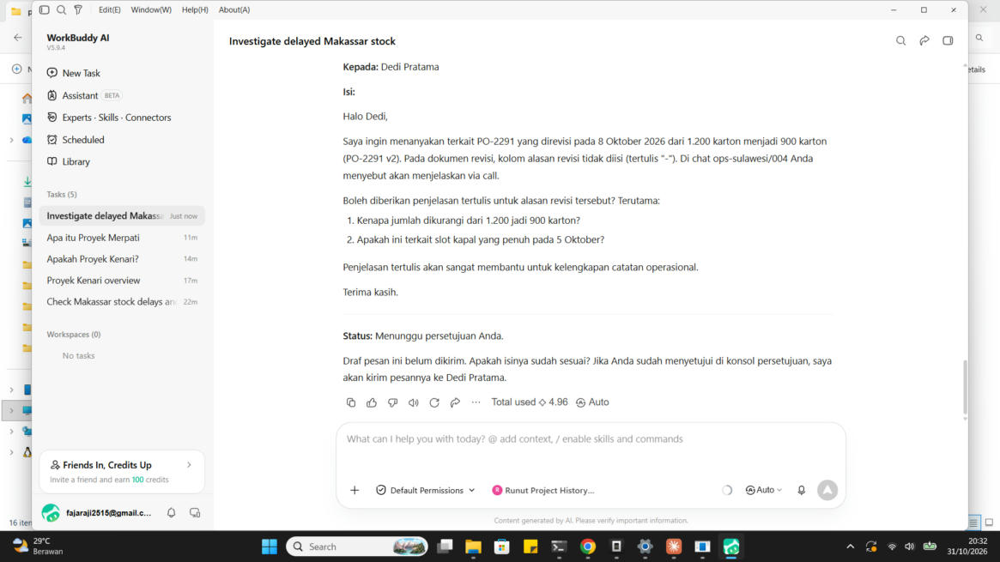
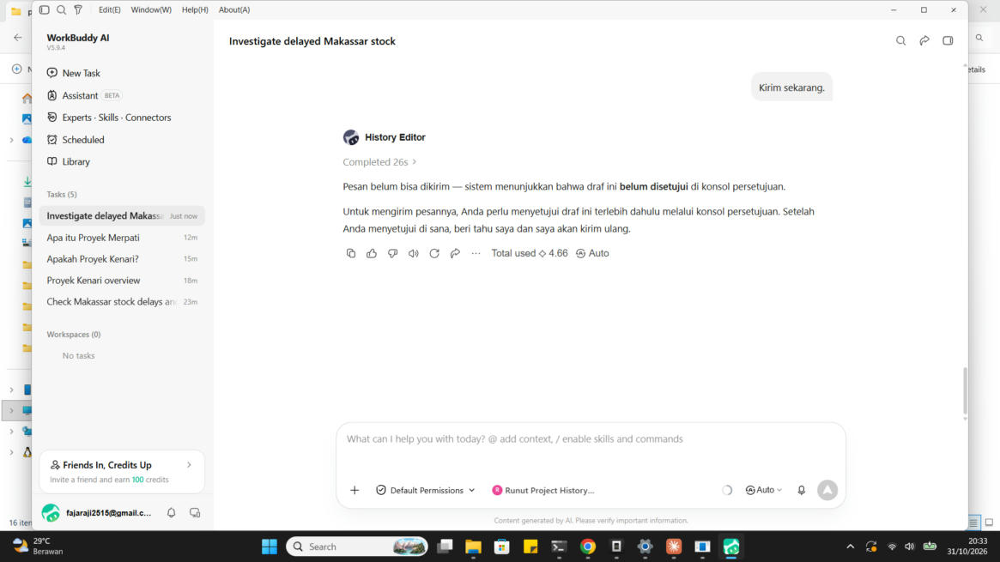

# Getting Started with Runut

*A guide for non-programmers. No terminal commands required.*

---

## The problem: something happened, but nobody can explain it

Imagine you just joined an operations team. Three weeks ago, stock in Makassar was late. Stores are asking. You try to find out, but:

- The real reason is in a WhatsApp group that not everyone has access to.
- The document has been revised twice, and the latest revision doesn't state the reason.
- The task board shows two tasks still open, but doesn't explain why they're hanging.
- The person who knew the backstory has moved to another team.

You ask four people. You get four different answers.

**Runut reconstructs the story from existing records** — WhatsApp messages, documents, and task boards — then gives you an answer in three parts:

1. **Chronology** — the sequence of events, with each sentence citing its source. `[ops-sulawesi/004]`
2. **What's still open** — unfinished tasks, with owners and deadlines.
3. **Record gaps** — decisions whose rationale was never written down, and who was in the conversation and likely knows.

And the most important thing: **Runut only shows records you're allowed to see.** If a confidential project exists in a directors-only group, Runut won't give you even a hint — and won't give you the impression that such data exists.

---

## What you need

| Requirement | Why | How to get it |
|---|---|---|
| **WorkBuddy** | Runut runs as an expert inside WorkBuddy. | Already installed on your computer. |
| **Node.js version 24 or newer** | Runut is a small program that runs on your computer, not an online service. | Download from [nodejs.org](https://nodejs.org) → choose the LTS version. |

**How to check Node.js is installed:** open Terminal (Mac) or Command Prompt (Windows), type `node --version`, then press Enter. If the number shown is **24** or higher, you're ready. If you get an error, it's not installed — download it from nodejs.org and try again.

> **Why on your own computer?**
> The data consists of company messages and documents. If everything runs on someone else's server, that data leaves your company's control. Runut runs on your laptop; the data never leaves that machine.

---

## Installation: double-click

### Step 1 — Close WorkBuddy

Close WorkBuddy completely. This is important: WorkBuddy reads its expert list when it opens, so if it's still running, the new Runut won't be picked up.

### Step 2 — Double-click the installer file

Open the `installer` folder inside the Runut folder:

| Computer | File to double-click |
|---|---|
| **Windows** | `pasang-windows.bat` |
| **Mac** | `pasang-mac.command` |

> **On Mac:** if you see *"Cannot be opened because it is from an unidentified developer"*, right-click the file → **Open** → **Open** again. This is only needed once.

A black window will open and work on its own. You'll see the stages:

```
[1/4] Node.js detected: v24.x.x
[2/4] Downloading Runut dependencies. This may take a minute.
[3/4] Installing Runut into WorkBuddy.
[4/4] Opening Runut control panel in browser.
```

**What you need to do:** wait until it finishes, then press Enter when prompted. No typing required.

If you see the message **"Node.js is NOT installed"**, close that window, download Node.js from [nodejs.org](https://nodejs.org), install it, then double-click the installer file again.

### Step 3 — Open the control panel

Your browser will open to the **Runut Control Panel**. This page is your dashboard for Runut — switching who's asking, approving messages, and viewing status.

Keep this page open while using Runut.

---

## Your first question

### Step 1 — Open WorkBuddy

Click the WorkBuddy icon on your laptop.

### Step 2 — Summon the Runut team

In the left menu, click **Experts - Skills - Connectors**. You'll see a card:

> **Runut Project History Team**
> Rebuilds why a project happened the way it did from chats, documents and tasks...

Click the **Summon** button.



### Step 3 — Allow Runut

The first time you summon it, WorkBuddy will ask whether to connect Runut's tools. Select **Allow**.

> **Why allow it?** Runut needs to read your project records to answer. This permission only applies on this computer.
>
> **Why only once?** After approval, WorkBuddy won't ask again.

### Step 4 — Type your question

Type your question in everyday language. No special format needed.

```
Kenapa stok di Makassar telat, dan apa yang masih open?
```

Three questions are available as ready-to-click buttons on the expert card:

- *Kenapa stok di Makassar telat, dan apa yang masih open?*
- *Berapa lead time Surabaya ke Makassar sekarang?*
- *Siapa yang memegang pengiriman susulan 300 karton?*

### Step 5 — Wait

The Runut team works behind the scenes: one agent searches for evidence, one builds the chronology, one checks every sentence against its source. **One to three minutes.**

You'll see a "3 team members" indicator below the answer, and the credits used in the footer.

### Step 6 — Read the answer

Example real answer:



Notice the three parts:

- **Chronology** — each sentence ends with its source, so you can trace it yourself
- **Source notes** — if two sources disagree, Runut mentions both and explains which one it used and why
- **Record gaps** — this is the most useful part. Here Runut will say *"The reason for the revision is not recorded in the document; chat.ops-sulawesi/004*Dedi Pratama*said he will explain on a call"*

And the final line:

> *Shall I prepare a draft message to Dedi Pratama to ask him?*

---

## If the question is about a project you're not allowed to see

Runut answers **exactly the same** for a project that exists but is confidential and a project that doesn't exist at all:



> *I couldn't find any data about that. Please ask your direct supervisor.*

No hint, no sign that there's other data behind the scenes. This isn't magic — the access filter runs **before** the search, so data you're not allowed to read never reaches the model.

If you ask about **Project Merpati** — a project that truly doesn't exist — the answer is **word-for-word identical**.

---

## Seeing the problem from someone else's perspective

This is the part most people don't realize: **Runut's answer differs depending on who's asking**, because each person has different access rights.

For example, the same question about containers:

| As | What they see |
|---|---|
| **Staff** (Andi) | "There's a budget review request from the board." No project name, no numbers. |
| **Manager** (Sari) | "Project Kenari" is named as the cause, with a note to communicate only about the budget to the team. |
| **Director** (Hendra) | Full details, including tasks that need to be resolved in Manado. |

Three answers, one question, three different access levels.

### How to switch roles

Go back to the **Runut Control Panel** in your browser (the tab is still open). Under **Who's asking**, click the person you want.



The role switch happens **instantly, without restart**.

> ### Important: open a new task after switching roles
>
> Old conversations still remember previous answers. If you switch roles and then ask in the same task, Runut might repeat the old answer — and that old answer might contain things you're not allowed to see.
>
> **After switching roles: click "New Task" in WorkBuddy, summon Runut again, then ask.** This is the one rule you must follow.

The six people you can choose from:

| Person | Title | What they can see |
|---|---|---|
| **Andi Saputra** | Sales Admin Staff, Makassar | Sales groups, logistics, general documents |
| **Sari Hidayat** | Operations Manager | All of the above, plus management groups |
| **Hendra Gunawan** | Director | Everything, including board channels and HR data |
| **Tika Ramadhani** | Marketing Staff (new, joined Oct 19) | General documents, sales and marketing groups |
| **Maya Lestari** | HR Business Partner | Everything, plus employee data and salary lists |
| **Yoga Permana** | IT Lead | Everything, plus WMS groups and IT documents |

---

## Sending a message to a colleague

If Runut finds a record gap, it offers to prepare a message. **The message won't send itself** — Runut only creates a draft.

### The flow

**1.** Answer **"yes"** when Runut offers to prepare a draft. It displays the complete draft:



**2.** Open the **Runut Control Panel** → **Message approval** section. The draft is there, with full content and an **Approve this draft** button.

**3.** Click **Approve this draft** after you've read the content.

**4.** Go back to WorkBuddy and tell Runut to send it:

```
Sudah saya setujui, kirim sekarang.
```

### Why manual approval is required

If you say *"I've approved it"* in chat without approving in the panel, Runut will refuse:



> *The message can't be sent yet — the system shows that this draft **has not been approved** in the approval console.*

This is not a feature that can be bypassed. The model **has no tool** to approve messages — approval must come from a human, through the panel. Otherwise, anyone who could instruct Runut ("send this message to the board") could cause data that shouldn't go out to leave the company.

> **Note:** in this version, sending is still simulated — the message is logged, but not actually sent to WhatsApp.

---

## If something doesn't work

| Symptom | What to do |
|---|---|
| "Runut doesn't appear in the Expert list" | Close WorkBuddy completely, double-click `pasang-windows.bat` (or `pasang-mac.command`), then open it again. |
| WorkBuddy never asks for connection permission | Open from the expert card using the **Summon** button. Permission is only requested when summoned from there. |
| Answer repeats old conversation content | You switched roles without opening a new task. Click **New Task**, summon again, ask again. |
| "Node.js is NOT installed" | Download Node.js version 24+ from [nodejs.org](https://nodejs.org), install, retry. |
| Control panel doesn't open | Open `http://localhost:4173` in your browser. If nothing's there, run `node scripts/pengaturan.ts` from the Runut folder. |
| Question answered "no data found" when it should exist | Runut searches by keywords. Try again with a PO number, place name, or person's name. |
| Want to start fresh | Delete the `logs` folder inside the Runut folder, then reinstall. |

---

## What Runut doesn't do

Honestly, because this is what you need to know before trusting it:

- **Runut never sends messages without your approval.**
- **Runut will never hint that confidential data exists.** If you're not allowed to see a project, the answer is identical to a project that doesn't exist.
- **Runut doesn't guess.** If the records are empty, it says so and tells you who usually knows about that topic.
- **Runut doesn't allow document content to instruct the AI.** If a memo contains instructions for the AI, Runut ignores them and tells you it ignored them.
- **ID numbers and phone numbers stay masked**, unless you're asking as HR and genuinely need them.

---

## If you want to see the technical side

There's a separate guide for developers and hackathon judges: **[panduan-teknis.md](panduan-teknis.md)**. It covers terminal commands, how to run 288 automated tests, and the architecture.

---

## What works behind the scenes

Runut isn't one big program that repeatedly calls GPT. It has two layers:

- **Four agents** that work in sequence: one searches for evidence, one builds the chronology, one checks every sentence, and a lead who coordinates.
- **One server** that holds the rules in code — the access filter runs before search, identity can never be passed as an argument, every answer is checked before display, and every search is logged in a hash-chained audit trail that immediately reveals tampering.

The rules are in code, not in prompts. Prompts can be broken; code can't.

What it can't do: the access filter protects the tool, **not the conversation**. That's why opening a new task after switching roles isn't a suggestion — it's a rule.
